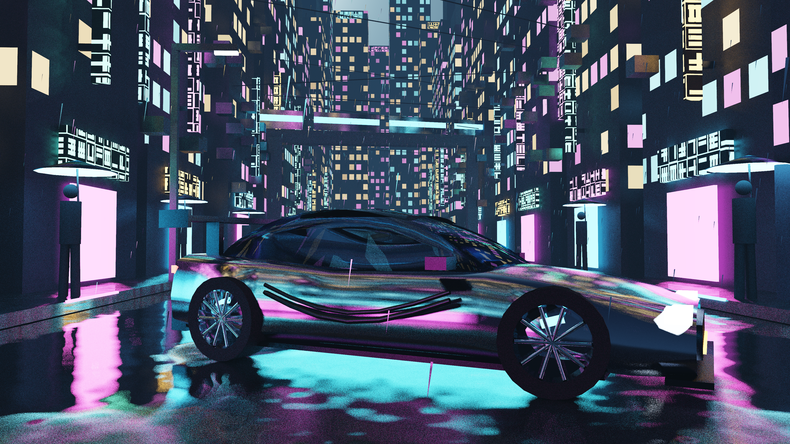

# Parallel Ray Tracing — Multi-Paradigm Path Tracer & Studio

> **CS3005 — Parallel and Distributed Computing (Fall 2026, FAST-NUCES)**  
> **Project #15:** Parallel Ray Tracing / 3D Rendering of Large Scenes  
> **Author:** Muhammad Ebrahim Bin Moin (`23K-0540`)



A high-performance Monte Carlo path tracer implemented across **five parallel computing models**—**Sequential**, **OpenMP**, **MPI**, **Hybrid (MPI + OpenMP)**, and **CUDA**—built around a single shared `__host__ __device__` C++17 ray-tracing engine, paired with a zero-dependency **offline Web Studio** (`server.py` + `web/index.html`) for live interactive rendering, tile/SM execution heatmaps, and hardware-adaptive scaling benchmarks.

---

## Key Features

### Five Parallel Backends on One Shared Engine (`src/common/`)
All five executables compile against the exact same math, BVH, material, scene, and shading headers (`RT_HD` = `__host__ __device__` under `nvcc`):
1. **Sequential (`bin/raytracer_seq`)** — Single-threaded CPU baseline and bit-exact PSNR/MSE reference.
2. **OpenMP (`bin/raytracer_omp`)** — Shared-memory multi-threading with runtime-selectable `static`, `dynamic`, and `guided` tile scheduling.
3. **MPI (`bin/raytracer_mpi`)** — Distributed-memory 2D tile decomposition supporting both contiguous `static` rows (`MPI_Gatherv`) and self-participating `dynamic` master–worker scheduling (Rank 0 renders while draining requests via scanline `MPI_Iprobe`).
4. **Hybrid MPI + OpenMP (`bin/raytracer_hybrid`)** — Initializes `MPI_THREAD_FUNNELED` with a **single persistent OpenMP thread team per rank**, a lock-free atomic tile queue on Rank 0, and 64-pixel dynamic micro-chunks across tile batches to minimize barrier/dispatch overhead.
5. **CUDA GPU (`bin/raytracer_cuda`)** — Optional NVIDIA GPU backend using 2D `block × block` pixel grids, iterative stack traversal, IEEE `--fmad=false` consistency, `cudaEventRecord` stage timing, and hardware `%smid` Streaming Multiprocessor heatmaps.

### Parallel & Engineering Invariants
- **Iterative Everything:** Flat AABB BVH with a fixed local stack (`int stack[64]`) and an iterative bounce loop (zero recursion) so CPU and GPU traverse identically.
- **Deterministic Stateless RNG:** Per-pixel PCG32 / Wang hash seeded strictly from `(seed, x, y, sample_idx)` — zero lock contention and bit-exact reproducibility (`inf` dB PSNR across Sequential, OpenMP, MPI, and Hybrid; `62–75 dB` PSNR on CUDA).
- **8K Memory Safety:** MPI workers allocate tile-sized RGB8 buffers rather than duplicating full `7680×4320` framebuffers across every rank.
- **Adaptive Hardware Portability:** Zero hardcoded core counts, rank counts, or GPU assumptions. Auto-detects host physical cores, logical threads, and CUDA availability at runtime, and builds/runs cleanly in CPU-only mode (`make NO_CUDA=1`, `python3 server.py --no-cuda`) while displaying saved 4K/8K desktop renders.

### Six Built-In Scenes
| Scene ID | Description |
| :--- | :--- |
| `cyberpunk_city` | Flagship sculpted widebody sports car on wet rain-rippled asphalt under cyber-glyph neon signs, lit skyscrapers, monorail, and umbrella pedestrians |
| `cyber_cathedral` | High-bounce neon pillars, refractive glass core, and floating monoliths inside a reflective mirror hall |
| `orbital_megastructure` | Orbital ringworld torus halo above a lit megacity skyline with volumetric dusk fog |
| `large_world` | Procedural multi-material field (glass, chrome, diffuse, emissive) scaling up to 25,000 objects |
| `studio_glass` | Heavy refractive glass-sphere cluster engineered to expose static vs. dynamic load imbalance |
| `mesh_showcase` | Smooth-normal `.obj` triangle mesh showcase (`assets/sample_mesh.obj` or custom `--obj` path) |

### Interactive Offline Web Studio (`server.py` + `web/index.html`)
- **Zero Dependencies:** Python 3 stdlib HTTP/job server and 100% offline single-page HTML/CSS/JS studio (no `pip install`, no external CDNs).
- **Controls & Inspection:** Quality presets (`Fast`, `HD`, `1080p`, `4K`, `8K`), 6 scenes, backend-aware concurrency sliders + `R×T` hybrid matrix picker, interactive **Render ↔ Tile/SM Heatmap** split slider, live stage timing breakdown, and a saved/recent render filmstrip (`results/gallery.json`).
- **Dark & Light Themes:** Cohesive studio dark and light theme toggle persisted in `localStorage`.

---

## Verified Benchmark Highlights

Measured on **AMD Ryzen 5 8400F (6 physical cores / 12 logical threads)** + **NVIDIA GeForce RTX 3050 (8 GB, `sm_86`)** in WSL2 Ubuntu (`make` with `-O3 -std=c++17`, `nvcc --fmad=false`). Full CSV/Markdown tables are in [results/report_summary.md](results/report_summary.md) and [results/report_benchmarks.csv](results/report_benchmarks.csv).

### 1. Model Comparison (`large_world`, `1280×720`, 8 SPP, Depth 8, 1000 Objects)
| Configuration | Total Compute (ms) | Throughput (MRays/s) | Speedup | Eff (%) | PSNR vs Seq |
| :--- | ---: | ---: | ---: | ---: | :--- |
| Sequential (`1×1`) | 10,189.53 | 1.64 | 1.00× | 100.0% | `inf` (exact) |
| OpenMP (`6T` dynamic) | 1,952.92 | 8.54 | 5.22× | 87.0% | `inf` (exact) |
| OpenMP (`12T` dynamic) | 1,437.12 | 11.61 | 7.09× | 59.1% | `inf` (exact) |
| MPI (`6R` dynamic) | 1,977.09 | 8.44 | 5.15× | 85.8% | `inf` (exact) |
| Hybrid (`2×3` dynamic) | 1,893.51 | 8.81 | 5.38× | 89.7% | `inf` (exact) |
| Hybrid (`3×4` dynamic) | 1,223.57 | 13.63 | **8.33×** | 69.4% | `inf` (exact) |
| CUDA RTX 3050 (`16×16`) | **36.55** | **456.29** | **278.78×** | — | **75.47 dB** |

*(In the full `hybrid_matrix` sweep on the same scene, **Hybrid `3×4`** reached **1,172.68 ms / 14.22 MRays/s / 9.00× speedup** vs. Sequential.)*

### 2. Load Imbalance (`studio_glass`, `1280×720`, 8 SPP)
| Configuration | Static (ms) | Dynamic (ms) | Guided (ms) | Best Speedup vs Seq |
| :--- | ---: | ---: | ---: | ---: |
| OpenMP `6T` | 7,008.32 | 5,306.47 | **4,845.05** | **5.57×** (`guided`) |
| OpenMP `12T` | 4,530.86 | 3,527.05 | **3,296.79** | **8.19×** (`guided`) |
| MPI `2R` | 17,981.53 | **13,820.53** | — | **1.93×** (`dynamic`) |
| MPI `6R` | 8,184.35 | **5,271.76** | — | **5.07×** (`dynamic`) |
| MPI `12R` | 6,311.02 | **3,696.38** | — | **7.22×** (`dynamic`) |

### 3. Resolution Scaling (`1080p` → `4K` → `8K`, `large_world`, 1000 Objects)
| Resolution | SPP | OpenMP `12T` (ms) | Hybrid `3×4` (ms) | CUDA RTX 3050 (ms) | CUDA MRays/s | CUDA vs OMP `12T` |
| :--- | ---: | ---: | ---: | ---: | ---: | ---: |
| **1080p** (`1920×1080`) | 8 | 3,327.96 | 3,343.72 | **72.97** | 514.28 | **45.61×** |
| **4K** (`3840×2160`) | 8 | 11,926.71 | 10,958.78 | **258.79** | 580.16 | **46.09×** |
| **8K** (`7680×4320`) | 4 | 21,098.30 | 21,142.70 | **510.33** | 588.54 | **41.34×** |

### 4. Complex Scene Showcase (`cyberpunk_city`, Depth 12, 2500 Objects)
- **720p (4 SPP):** Sequential `43.30 s` → OpenMP `12T` `5.47 s` (`7.92×`) → Hybrid `3×4` `5.36 s` (`8.08×`, bit-exact) → **CUDA `231.42 ms` (`187.11×`, 62.32 dB PSNR)**
- **4K CUDA (16 SPP / 24 SPP):** `5.74 s` / `8.46 s` (`75.3–76.6 MRays/s`)
- **8K CUDA (4 SPP):** `5.91 s` (`73.15 MRays/s`)

<details>
<summary>Saved Curated Renders & Tile/SM Heatmaps in <code>results/renders/</code></summary>

- [Cyberpunk City — 4K RTX 3050](results/renders/showcase_cyberpunk_city_4k.png) ([SM Heatmap](results/renders/showcase_cyberpunk_city_4k_hm.png))
- [Large World — 8K Ultra HD (7680×4320)](results/renders/showcase_large_world_8k.png) ([SM Heatmap](results/renders/showcase_large_world_8k_hm.png))
- [Cyber Cathedral — 4K RTX 3050](results/renders/showcase_cyber_cathedral_showcase.png) ([SM Heatmap](results/renders/showcase_cyber_cathedral_showcase_hm.png))
- [Orbital Megastructure — 4K RTX 3050](results/renders/showcase_orbital_megastructure_showcase.png) ([SM Heatmap](results/renders/showcase_orbital_megastructure_showcase_hm.png))
- [Studio Glass — Hybrid Dynamic (3×4)](results/renders/showcase_studio_glass_hybrid_dynamic.png) ([Tile Heatmap](results/renders/showcase_studio_glass_hybrid_dynamic_hm.png))
- [Studio Glass — MPI Static (6R)](results/renders/showcase_studio_glass_mpi_static.png) ([Tile Heatmap](results/renders/showcase_studio_glass_mpi_static_hm.png))

</details>

---

## Quick Start (Ubuntu / WSL2)

### 1. Install Toolchain (Once)
```bash
bash scripts/setup_wsl.sh          # Full toolchain (g++, make, OpenMPI, CUDA toolkit)
# Or on a CPU-only machine:
bash scripts/setup_wsl.sh --cpu-only
```

### 2. Build Binaries
```bash
make                # Builds all 5 binaries (CUDA built automatically if nvcc is found)
# Force CPU-only build (skips raytracer_cuda cleanly):
make NO_CUDA=1
```

### 3. Launch the Interactive Web Studio
```bash
python3 server.py
# Or simulate a CPU-only machine (loads saved RTX 3050 4K/8K showcase items cleanly):
python3 server.py --no-cuda
```
Open **`http://localhost:8000`** in your browser.

### 4. CLI Usage Examples
All five binaries share a uniform CLI and emit `JSON_RESULT:{...}` telemetry:

```bash
# Sequential baseline
./bin/raytracer_seq --scene large_world --width 1280 --height 720 --spp 8 --depth 8 --objects 1000 --output out_seq.png

# OpenMP (dynamic schedule)
OMP_NUM_THREADS=12 ./bin/raytracer_omp --scene studio_glass --width 1920 --height 1080 --spp 8 --threads 12 --schedule dynamic --output out_omp.png --heatmap hm_omp.png

# MPI (dynamic load-balanced tiles)
mpirun --bind-to none --use-hwthread-cpus -np 6 ./bin/raytracer_mpi --scene studio_glass --width 1920 --height 1080 --spp 8 --mpi-mode dynamic --output out_mpi.png --heatmap hm_mpi.png

# Hybrid MPI + OpenMP (e.g., 3 ranks x 4 threads = 12 workers)
mpirun --bind-to none --use-hwthread-cpus -np 3 -x OMP_NUM_THREADS=4 ./bin/raytracer_hybrid --scene cyberpunk_city --width 1920 --height 1080 --spp 8 --depth 12 --objects 2500 --threads 4 --schedule dynamic --mpi-mode dynamic --output out_hybrid.png --heatmap hm_hybrid.png

# CUDA GPU (4K cyberpunk render)
./bin/raytracer_cuda --scene cyberpunk_city --width 3840 --height 2160 --spp 24 --depth 12 --objects 2500 --block 16 --output out_cuda_4k.png --heatmap hm_cuda_4k.png
```

### 5. Run Automated Benchmarks & Export Reports
```bash
python3 scripts/benchmark.py --suites all --showcase --reset-benchmarks --reset-gallery
```

---

## Repository Structure

```text
├── assets/
│   └── sample_mesh.obj          # Smooth-normal sample OBJ mesh (512 triangles)
├── results/
│   ├── benchmarks.json          # Saved benchmark suites (loaded by Web Studio)
│   ├── gallery.json             # Pinned showcase renders (loaded on startup)
│   ├── report_benchmarks.csv    # Full tabular benchmark export
│   ├── report_summary.md        # Markdown summary tables for reports
│   └── renders/                 # Curated 1080p / 4K / 8K showcase PNGs + heatmaps
├── scripts/
│   ├── benchmark.py             # Automated adaptive CLI benchmark & showcase runner
│   └── setup_wsl.sh             # Ubuntu / WSL2 dependency installer & checker
├── src/
│   ├── common/                  # Shared __host__ __device__ C++17 ray-tracing engine
│   │   ├── aabb.h, bvh.h        # Flat iterative BVH + IEEE NaN/Inf slab test
│   │   ├── cli_and_io.h         # Uniform CLI flags + JSON_RESULT telemetry emitter
│   │   ├── material.h, scene.h  # 9 procedural/metallic/glass/wet-asphalt shaders & 6 scenes
│   │   ├── obj_loader.h         # Wavefront .obj parser with smooth vertex normals
│   │   ├── png_writer.h         # Zlib Sub-filtered PNG + HSV tile/SM heatmap writer
│   │   ├── primitive.h, ray.h   # Spheres + Möller–Trumbore triangles
│   │   ├── renderer.h, rng.h    # Iterative path tracer + stateless PCG32 RNG
│   │   ├── rt_common.h, vec3.h  # RT_HD portability macros & 3D vector/matrix math
│   ├── seq_main.cpp             # Sequential backend
│   ├── omp_main.cpp             # OpenMP backend
│   ├── mpi_main.cpp             # MPI backend (static + Iprobe dynamic)
│   ├── hybrid_main.cpp          # Hybrid MPI + OpenMP persistent-team backend
│   └── cuda_main.cu             # Optional CUDA GPU backend
├── web/
│   └── index.html               # 100% offline single-page Studio UI (Dark & Light mode)
├── server.py                    # Zero-dependency Python 3 REST & render server
├── Makefile                     # Adaptive CPU / CUDA build system (NO_CUDA=1 safe)
├── AGENTS.md                    # Engineering invariants & hardware scaling rules
├── IMPLEMENTATION_PLAN.md       # Phased architecture & verification log
└── README.md
```
